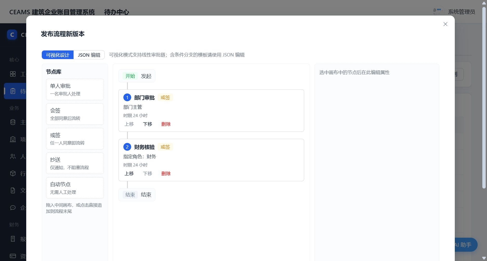
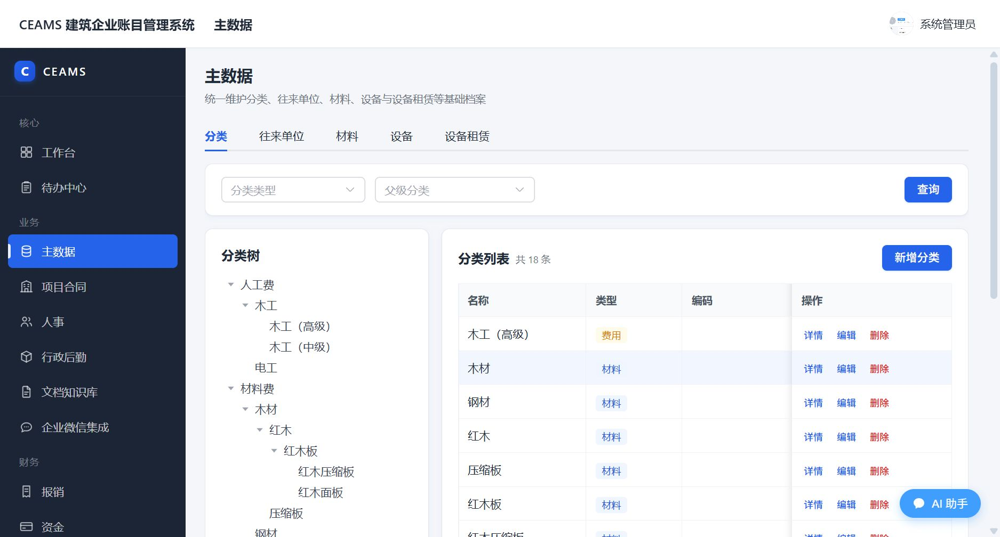
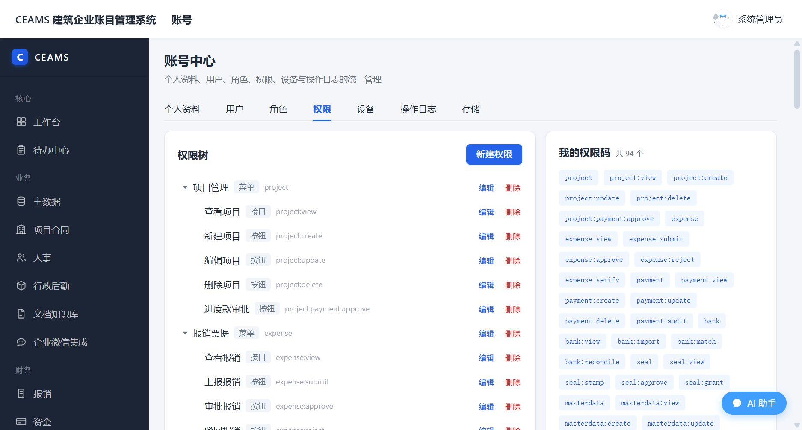
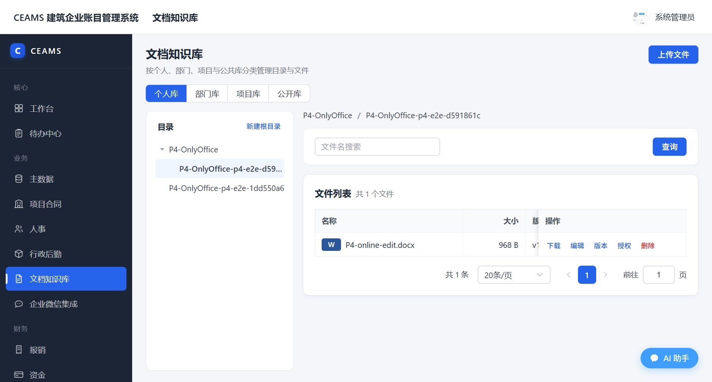
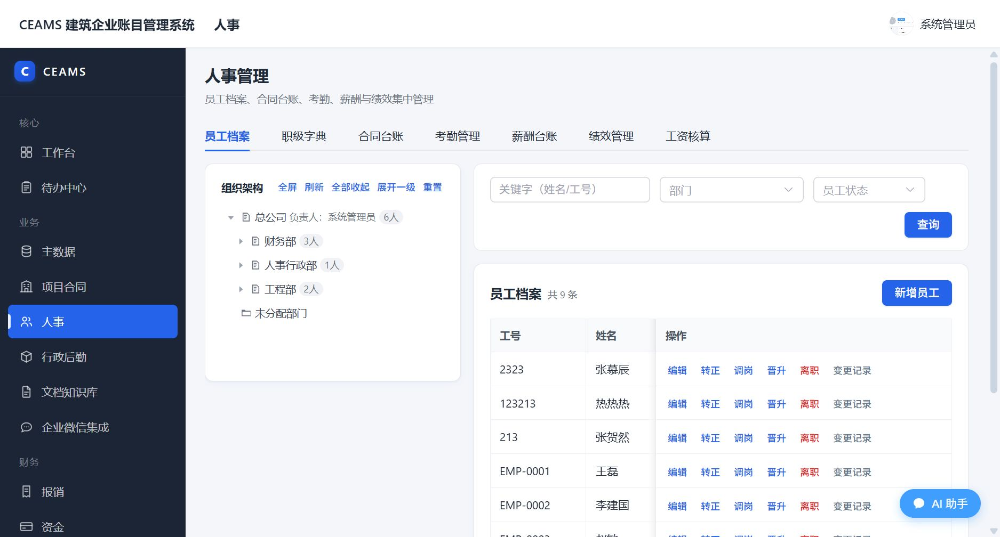
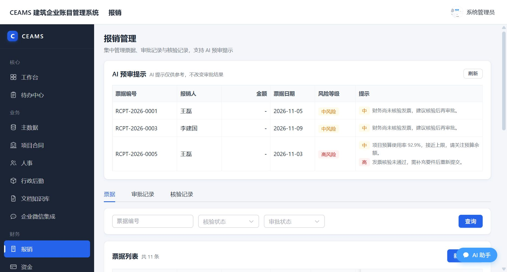
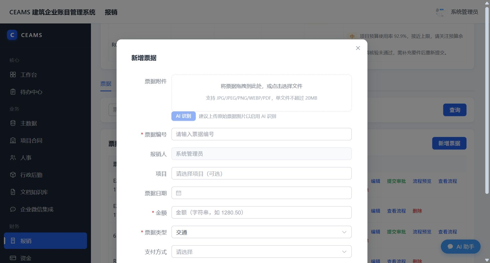
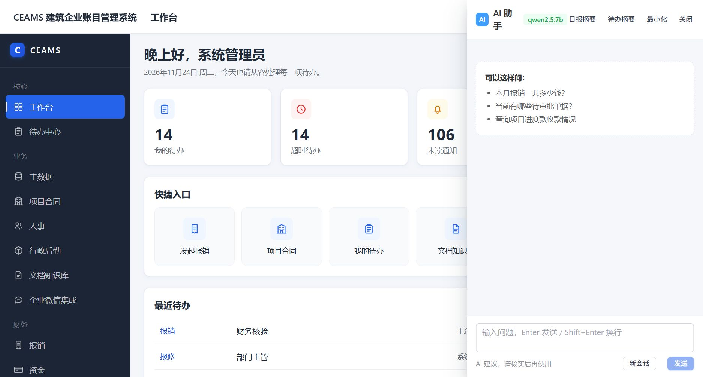
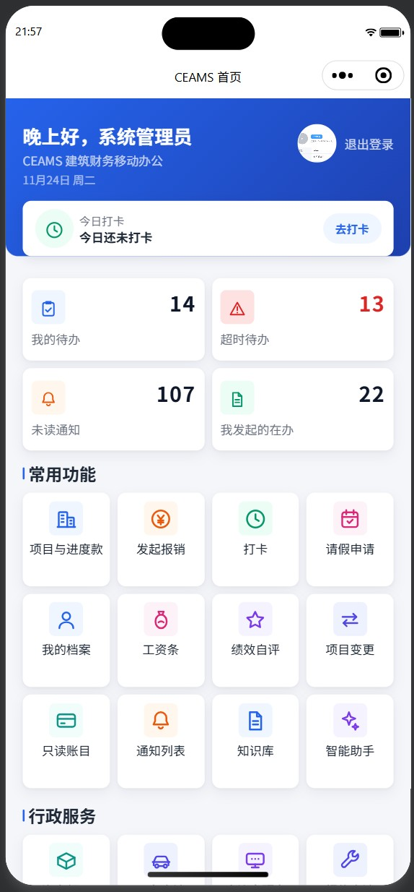

# CEAMS 建筑企业账目管理系统（shengyun-oa）

## 一、项目简介

CEAMS 是面向中小建筑企业的一体化业务管理系统，把项目管理、合同、报销、资金、银行对账、电子印章、文档、人事行政和审批流整合到一套系统里。它解决的是建筑企业「合同台账分散在 Excel、报销靠微信审批、资金与银行流水对不上账」的问题。系统提供 Web 管理端与微信小程序两种形态，业务人员可以在电脑上做账，在手机上随时审批。

## 二、效果截图

> 截图目录：`docs/screenshots/`。

**Web 管理端**

| 页面 | 说明 |
|------|------|
|  | 流程模板发布新版本，可视化编排审批节点与审批人 |
|  | 分类树、往来单位、材料档案、设备台账统一维护 |
|  | 权限节点树形维护，支持菜单/接口/按钮三级颗粒度 |
|  | 目录树、文件版本、在线预览与知识库问答入口 |
|  | 员工档案、组织树、入转调离与合同台账 |
|  | 票据列表、风险提示、审批与核验状态跟踪 |
|  | 票据录入、附件上传与金额/日期校验 |
|  | 自然语言查询业务数据，回答附带数据来源 |

**微信小程序**

| 页面 | 说明 |
|------|------|
|  | 待办、超时待办、未读通知与常用功能入口，按权限动态展示 |

## 三、功能清单

- **账号与权限（IAM）**：JWT 双令牌登录、在线会话管理、用户/角色/权限点三级授权、设备管理与操作日志审计
- **主数据**：分类树、往来单位、材料档案（价格/规格/计量单位）、设备台账与设备租赁
- **项目与合同**：项目台账、项目预算与超支预警、变更单、进度款申请与实付跟踪、分包商与分包合同
- **报销管理**：票据上传与 OCR 识别、报销单提交与审批、报销额度分级规则（项目 → 部门 → 通用）
- **资金管理**：资金账户、收支流水、成本归集与分摊
- **银行对账**：流水导入、自动匹配候选、方向一致性校验、人工确认对账
- **电子印章**：印章台账、用印申请与审批、PDF 盖章、盖章记录与使用审计、印章授权
- **流程引擎（BPM）**：流程模板与版本、或签/会签节点、委托与抄送、审批人解析、流程预览
- **文档中心**：目录树、文件上传与版本管理、OnlyOffice 在线编辑、编辑锁、分片上传
- **知识库问答**：文档正文抽取与分块检索，回答附带可点击的来源引用
- **人事行政**：员工档案与组织树、职级、入转调离（转正/调岗/晋升/离职）、合同台账、绩效考核、资产/会议室/车辆/访客/材料/保修
- **通知中心**：按全员/多角色/指定用户定向发布，已发布通知仅可撤销
- **报表与仪表盘**：按角色授权的经营报表与 Excel 导出
- **AI 办公**：AI 对话、每日经营摘要、待办摘要、合同风险提示、票据预审（默认关闭，可配置外部模型）
- **双端形态**：Web 管理端（完整业务办理）与微信小程序（移动审批与查询）

## 四、技术栈

| 层次 | 技术 |
|------|------|
| 后端 | Java 17、Spring Boot 3.2.5、Spring Security、MyBatis-Plus 3.5.7、MapStruct 1.5.5、Flyway、Bean Validation |
| 数据库 | MySQL 8（Flyway 增量迁移，V1～V56 共 55 个脚本）、Redis 7（防重放 nonce、编辑锁、分片会话、分布式锁） |
| 前端 Web | Vue 3、TypeScript、Vite、Element Plus、Pinia、Vue Router、Axios |
| 小程序 | uni-app（Vue 3）编译微信小程序 |
| 文档与 AI | OnlyOffice Document Server（在线编辑）、Apache Tika 3.2.3（正文抽取）、Ollama / OpenAI 兼容接口 |
| 工程化 | pnpm workspace、ESLint、vue-tsc、JUnit 5 + Mockito、Docker Compose |

## 五、项目亮点

以下为我在项目中承担的核心设计与实现，而非项目既有功能的罗列。

- **一套契约驱动双端**：以 OpenAPI v1 为唯一接口来源，生成统一 TypeScript SDK（`packages/api-client` + `packages/types`），Web 与小程序共用同一套请求层与类型定义，避免两端重复联调。
- **JWT 双令牌与并发刷新单飞**：refresh token 一次性使用；针对多个请求同时 401 的场景，在请求层实现模块级 singleflight，保证只会发起一次刷新，避免刷新令牌被并发消费导致全体掉线。
- **雪花 ID 精度治理**：所有返回前端的 Long 型 ID（含 BPM、保修、文档等 VO）统一用 `ToStringSerializer` 序列化为字符串，从根上解决 19 位 ID 超出 JavaScript 安全整数范围、前端回传后查不到数据的问题。
- **报销额度规则匹配器**：独立设计额度规则模型，按「项目规则优先 → 部门规则（含子部门）→ 通用兜底」匹配，金额区间左闭右开且禁止同维度重叠；提交报销时直接决定审批链，无匹配即拒绝并给出可读提示。
- **BPM 引擎细节补齐**：实现或签节点任意一人驳回时关闭同节点其余待办再回退（与同意逻辑对称）；审批人解析按业务单据中的员工取直属上级；新增流程预览接口，支持单据未创建时按目标员工解析审批链。
- **印章高危接口防护**：盖章接口强制校验印章 ACTIVE、申请 APPROVED、申请与请求印章一致，并叠加 HMAC 签名（X-Sign / X-Timestamp / X-Nonce）、±5 分钟时间窗与 nonce 防重放；盖章文件下载走 5 分钟签名临时 URL 并记录导出审计。
- **知识库 RAG 权限前置**：先按 `DocAccessResolver` 校验用户 PREVIEW 权限、过滤无权限片段，再将片段送入模型上下文，杜绝「先召回后过滤」导致的越权泄露；回答强制附带文件、目录与片段引用。
- **AI 摘要双向数字校验**：模板生成与润色结果做双向校验——模板中的数字必须全部保留、润色不得新增数字；校验失败或模型超时自动回退模板，杜绝大模型编造金额。
- **依赖冲突定位**：排查出 Tika 2.9.2 与 PDFBox 3.0.4 的 `NoSuchMethodError` 不兼容问题，升级 Tika 3.2.3 并覆盖 `commons-lang3` 至 3.17.0，恢复文档正文抽取链路。
- **低配生产落地**：为 2 核 4G 服务器设计部署方案——关闭 OnlyOffice 与 Ollama、仅保留 app/mysql/redis/nginx 四个容器、增加 2G swap、按服务限制内存（后端 1.5G、MySQL buffer 256M、Redis 128M），并在本地构建镜像后上传，规避服务器 OOM。

## 六、目录结构

```
.
├── src/                          # 后端 Spring Boot
│   ├── main/java/com/ceams/
│   │   ├── common/               # 统一响应、异常、安全、审计、工具
│   │   └── module/               # iam / project / masterdata / expense / payment /
│   │                             # bank / seal / doc / bpm / hr / admin / report /
│   │                             # ai / notification / file / integration
│   ├── main/resources/
│   │   ├── db/migration/         # Flyway 脚本 V1～V56
│   │   └── application.yml       # 统一配置，敏感项走环境变量
│   └── test/java/                # JUnit 5 单元测试（118 个）
├── apps/
│   ├── web/                      # Web 管理端（Vue 3 + Element Plus）
│   └── miniprogram/              # 微信小程序（uni-app）
├── packages/
│   ├── api-client/               # 统一请求层与领域 API
│   └── types/                    # 共享 TypeScript 类型
├── deploy/                       # 生产部署：Dockerfile + docker-compose.yml
├── docs/                         # 架构、部署、功能清单、OpenAPI 规范
│   └── openapi/                  # 各业务域 OpenAPI YAML
├── scripts/                      # 初始化与种子数据脚本
└── pom.xml / package.json        # 后端与前端工程入口
```

## 七、运行步骤

### 1. 环境准备

| 依赖 | 版本 |
|------|------|
| JDK | 17+ |
| Maven | 3.8+ |
| Node.js | 20.19+ |
| pnpm | 9+ |
| MySQL | 8.0 |
| Redis | 7 |

### 2. 获取代码

```bash
git clone https://github.com/Georges4151/shengyun-oa.git
cd shengyun-oa
```

### 3. 初始化数据库

新建空库即可（表结构与种子数据由 Flyway 自动执行）：

```sql
CREATE DATABASE ceams DEFAULT CHARACTER SET utf8mb4 COLLATE utf8mb4_general_ci;
```

### 4. 配置环境变量

后端读取以下环境变量，未设置时使用括号内默认值：

```bash
MYSQL_HOST=localhost
MYSQL_PORT=3306
MYSQL_DATABASE=ceams
MYSQL_USER=root
MYSQL_PASSWORD=你的数据库密码

REDIS_HOST=localhost
REDIS_PORT=6379
REDIS_PASSWORD=你的Redis密码

JWT_SECRET=至少32字节的随机密钥
CEAMS_SENSITIVE_KEY=敏感字段加密密钥
EXPORT_SECRET=导出签名密钥

AI_ENABLED=false
```

### 5. 启动后端

```bash
mvn spring-boot:run
# 启动后：http://localhost:8080，健康检查 /actuator/health
# 接口前缀：/api/v1
```

### 6. 启动 Web 前端

```bash
pnpm install
pnpm dev
# 访问 http://localhost:5173
```

### 7. Docker 一键部署（可选）

```bash
cd deploy
# 按 deploy/.env 填写数据库密码、Redis 密码、JWT_SECRET 等（该文件不得提交到版本库）
docker compose up -d --build
# 也可直接使用 deploy/start.bat / stop.bat（Windows）
```

### 8. 默认账号

| 账号 | 密码 | 角色 |
|------|------|------|
| admin | admin123 | SYS_ADMIN |

> 首次登录后请立即修改密码。

### 9. 质量检查

```bash
mvn test          # 后端单元测试
pnpm typecheck    # Web 与小程序类型检查
pnpm lint         # ESLint
```

## 八、接口文档

- 统一前缀：`/api/v1`
- 认证方式：请求头 `Authorization: Bearer <accessToken>`
- 统一响应结构：

```json
{
  "code": 0,
  "message": "success",
  "data": {},
  "traceId": "c1f0a6b8f2d94f0e",
  "timestamp": "2026-11-24T10:30:00"
}
```

- `code` 为 0 表示成功，非 0 为业务错误码；`traceId` 可用于日志追踪。
- 各业务域完整 OpenAPI 规范见 `docs/openapi/*.yaml`（iam、project、expense、payment、bank、masterdata、seal、report、file、notification）。

### 登录示例

`POST /api/v1/auth/login`

请求体：

```json
{
  "username": "admin",
  "password": "admin123",
  "deviceId": "web-001",
  "deviceName": "Chrome on Windows",
  "platform": "WEB"
}
```

响应示例：

```json
{
  "code": 0,
  "message": "success",
  "data": {
    "tokenPair": {
      "accessToken": "eyJhbGciOiJIUzI1NiJ9...",
      "refreshToken": "b7d2c1e4-9a3f-4c21-8e77-0f5a6d3b9c10",
      "expiresIn": 7200
    },
    "user": {
      "id": "1859032746123456789",
      "username": "admin",
      "name": "系统管理员"
    }
  },
  "traceId": "9f2a7c1d4b6e",
  "timestamp": "2026-11-24T10:30:00"
}
```

### 常用接口

| 方法 | 路径 | 说明 |
|------|------|------|
| POST | `/api/v1/auth/login` | 账号密码登录，签发双令牌 |
| POST | `/api/v1/auth/refresh` | 刷新 access token（refresh token 一次性） |
| POST | `/api/v1/auth/logout` | 登出并失效当前会话 |
| GET | `/api/v1/projects` | 项目台账分页查询（支持名称/客户/状态筛选） |
| POST | `/api/v1/projects` | 新建项目 |
| GET | `/api/v1/projects/{id}` | 项目详情 |
| GET | `/api/v1/expenses` | 报销单分页查询 |
| POST | `/api/v1/expenses` | 提交报销（触发额度规则匹配与审批流） |
| GET | `/api/v1/expense/amount-rules` | 报销额度规则列表 |
| GET | `/api/v1/bpm/tasks/pending` | 我的待办审批 |
| POST | `/api/v1/bpm/tasks/{id}/approve` | 同意审批 |
| GET | `/api/v1/bpm/instances/{id}` | 流程实例详情（含节点审批人） |
| GET | `/api/v1/bank/statements` | 银行流水查询 |
| POST | `/api/v1/bank/reconciliations` | 发起对账匹配 |
| GET | `/api/v1/doc/files` | 文档列表 |
| POST | `/api/v1/doc/files/upload` | 文件上传（白名单 + 大小限制） |
| GET | `/api/v1/ai/todo-summary` | AI 待办摘要 |

## 九、常见问题（FAQ）

**1. 前端某几个请求同时 401，随后大量报「登录已过期」？**
access token 过期时多个并发请求会同时触发刷新，而 refresh token 是一次性的。解决方式是在请求层用模块级 Promise 做 singleflight，只允许一个刷新请求在途，其余请求等待同一结果。

**2. 详情页传回的 ID 与后端不一致、提示数据不存在？**
19 位雪花 ID 超过 JavaScript 安全整数范围（2^53-1），JSON 解析会丢失精度。后端对所有对外 Long 型 ID 统一加 `@JsonSerialize(using = ToStringSerializer.class)`。

**3. 上传文档后正文抽取失败，日志报 `NoSuchMethodError`？**
Tika 2.9.2 与 PDFBox 3.0.4 不兼容。升级 Tika 到 3.2.3，并显式覆盖 `commons-lang3` 到 3.17.0。

**4. 小程序接口全部请求失败，域名还是 `api.example.com`？**
小程序生产构建只读取 `.env.production`，未配置 `VITE_API_BASE_URL` 时会静默回退占位域名；同时在微信开发者工具中需要「清除全部缓存」后重新编译。

**5. 盖章接口调用返回签名校验失败？**
签名需要 `X-Sign / X-Timestamp / X-Nonce` 三个请求头，时间戳必须与服务器相差 5 分钟以内，nonce 不可重复。服务端使用常量时间比较，且校验印章状态、申请状态与印章 ID 三者一致。

**6. 删除文档后再次编辑提示被锁定？**
删除时若只做逻辑删除，Redis 编辑锁不会释放。必须在软删前调用幂等解锁方法，保证数据库与 Redis 锁状态一致。

**7. 生产环境容器启动后接口 401，本地正常？**
生产 `JWT_SECRET` 长度不足 32 字节会触发弱密钥异常；同时确认 `.env` 中的密钥通过环境变量注入，且未把本地 `application.yml` 的调试配置带到线上。

## 十、TODO / 未来计划

- 知识库检索从 MySQL FULLTEXT 升级为向量检索（Qdrant + bge-m3），提升语义召回效果
- 引入 CI（GitHub Actions）：自动执行 `mvn test`、`pnpm typecheck`、前端构建与镜像构建
- 补齐 Web 端与小程序端的端到端测试，覆盖报销、审批、对账主流程
- 报表模块支持自定义维度与指标，减少新增报表的重复开发
- 审批流支持会签比例、动态加签与超时自动流转
- 接入企业微信/钉钉消息推送，替代轮询式待办提醒
- 移动端离线缓存待办列表，弱网环境下可查看与预填单据
